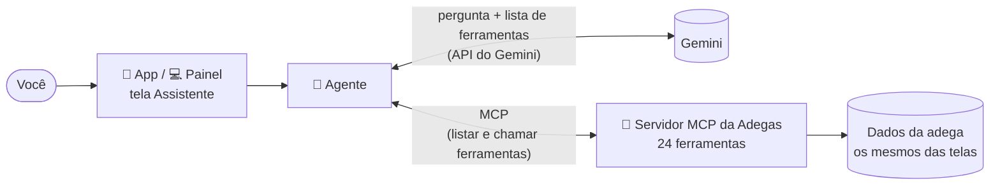

# Assistente com IA (Gemini + MCP)

O assistente é uma conversa dentro do app (aba **Assistente**) e do painel (menu **Assistente**). Você escreve do seu jeito e ele consulta ou registra na plataforma: estoque, entradas, vendas, contas das mesas, financeiro, relatórios e lembretes.

## O que pedir

| Você escreve | O que ele faz |
|---|---|
| "Quanto tem de Skol?" | Mostra o estoque, o mínimo, quanto vendeu em 30 dias e para quantos dias o estoque dá |
| "O que preciso repor?" | Lista o que está abaixo do mínimo ou zerado |
| "Chegaram 3 fardos de Skol por R$ 33 cada" | **Registra a entrada**: soma no estoque, recalcula o custo médio e lança a despesa |
| "Chegou 1 caixa de Heineken 600 a R$ 7 a garrafa" (produto que não existe) | Pergunta categoria e preço de venda e **cadastra o produto** junto com a entrada |
| "Quebrou 2 garrafas de vinho" | **Ajusta o estoque** como perda |
| "Vendi 2 Red Bull no dinheiro, ele me deu 30" | **Registra a venda** e diz o troco |
| "A mesa 10 pediu uma Coca, uma água e uma Skol" | **Lança na conta da mesa 10** (abre a mesa se ainda não estiver aberta); os itens saem do estoque |
| "Tira uma Skol da mesa 10" | **Tira da conta** e devolve ao estoque |
| "Quanto deu a mesa 10?" / "Quanto fica para cada um, em 3?" | Mostra a conta da mesa e quanto dá por pessoa |
| "Fecha a mesa 10 no Pix" / "...no dinheiro, ele deu 100" | **Fecha a conta**: vira venda, entra no financeiro e diz o troco |
| "Quais mesas estão abertas?" | Lista as mesas abertas, o total em aberto e as fechadas hoje |
| "Paguei R$ 289,90 de luz no Pix" | **Lança a despesa** no financeiro |
| "Muda o preço da Brahma para R$ 5,50" | **Edita o produto** |
| "Qual o saldo do mês?" / "Quanto gastei com mercadoria em setembro?" | Busca o financeiro do período |
| "Como foram as vendas na última semana?" / "Qual o horário de pico?" | Busca o relatório de vendas |
| "Me lembre de pagar o boleto da distribuidora sexta às 10h" | **Cria um lembrete** (aparece no Início do app e do painel) |
| "Já paguei o boleto" | Conclui o lembrete |

Quando ele muda alguma coisa, aparece uma etiqueta verde com o que foi feito (ex.: "Registrar entrada · skol") e um atalho para conferir ("Ver estoque →"). Se faltar informação ou o nome servir para mais de um produto, ele pergunta antes de registrar.

## Como ligar (uma vez em cada aparelho)

1. Entre em **https://aistudio.google.com/apikey** com uma conta Google e toque em **Create API key** (Criar chave). Copie a chave (começa com `AIza…`).
2. No app: aba **Assistente** → ícone de engrenagem → cole a chave → **Salvar**.
   No painel: menu **Assistente** → **Configurar** → cole a chave → **Salvar**.

A chave fica guardada **só naquele aparelho** (no celular, no cofre do sistema; no navegador, no armazenamento do site). O plano gratuito do Gemini tem limite de uso por minuto e por dia; passando disso, o Google cobra na conta dele.

O modelo padrão é o **`gemini-3.8-flash`**. Se ele não existir para a sua chave, o assistente escolhe sozinho o Flash mais novo disponível. Dá para trocar no campo "Modelo".

## Como funciona



1. O agente manda para o Gemini a sua mensagem e a lista de ferramentas que o **servidor MCP** da Adegas oferece.
2. O Gemini decide quais ferramentas usar (ex.: `consultar_produto` com "skol").
3. O agente chama a ferramenta **pelo protocolo MCP**, recebe o resultado e devolve ao Gemini.
4. Isso se repete até o Gemini escrever a resposta final.

O servidor MCP usa as mesmas regras do núcleo (`packages/core`) que as telas usam: uma entrada feita pelo assistente é igual a uma feita pela tela de Entrada de produto. No app e no painel, o servidor roda dentro do próprio aparelho e conversa com o agente pela memória.

### Ferramentas do servidor MCP

| Ferramenta | O que faz | Muda dados? |
|---|---|---|
| `buscar_produtos` | Lista produtos por nome, categoria e situação | não |
| `consultar_produto` | Estoque, preço, custo, vendas em 30 dias, duração do estoque, últimas movimentações | não |
| `resumo_estoque` | Total, valor parado e o que precisa repor | não |
| `registrar_entrada` | Entrada de mercadoria (fardo ou unidade), com cadastro de produto novo | **sim** |
| `ajustar_estoque` | Perda, consumo próprio ou contagem | **sim** |
| `editar_produto` | Nome, categoria, preço de venda, estoque mínimo | **sim** |
| `registrar_venda` | Venda com forma de pagamento e troco | **sim** |
| `listar_mesas` | Mesas abertas (itens, total, tempo), total em aberto e fechadas hoje | não |
| `consultar_mesa` | Conta de uma mesa, com divisão por pessoa | não |
| `abrir_mesa` | Abre a conta de uma mesa | **sim** |
| `lancar_na_mesa` | Lança pedidos na mesa (abre se precisar); saem do estoque | **sim** |
| `remover_da_mesa` | Tira um item da conta e devolve ao estoque | **sim** |
| `fechar_mesa` | Fecha a conta com a forma de pagamento (vira venda) | **sim** |
| `cancelar_mesa` | Cancela a conta; tudo volta ao estoque | **sim** |
| `resumo_do_dia` | Vendas, lucro, despesas e recebido por forma de pagamento de hoje | não |
| `resumo_financeiro` | Entradas, saídas, saldo, lucro, saídas por categoria e perdas de um período | não |
| `listar_lancamentos` | Movimentações do financeiro com filtros | não |
| `registrar_lancamento` | Despesa da loja ou outra entrada de dinheiro | **sim** |
| `excluir_lancamento` | Apaga uma movimentação lançada à mão | **sim** |
| `relatorio_vendas` | Faturamento, ticket, margem, melhores dias, picos, mais vendidos, parados, categorias | não |
| `criar_lembrete` | Lembrete com data e hora (e produto, se houver) | **sim** |
| `listar_lembretes` | Pendentes (e concluídos, se pedir) | não |
| `concluir_lembrete` | Marca como feito | **sim** |
| `excluir_lembrete` | Apaga | **sim** |

Períodos: `hoje`, `7d`, `30d`, `mes` ou datas de início e fim (`AAAA-MM-DD`). Valores em reais.

## Usar o servidor MCP com outros programas

O mesmo servidor também roda no computador, pelo terminal (transporte stdio), para qualquer cliente MCP: **Gemini CLI**, Claude Desktop, editores de código etc. Nesse modo os dados ficam num arquivo, `~/.adegas/dados.json` (troque com a variável `ADEGAS_DADOS`), começando com os dados de exemplo.

Dentro da pasta do projeto, depois do `npm install`:

```bash
node --import tsx packages/ia/src/node/servidor-stdio.ts
```

**Gemini CLI** (`~/.gemini/settings.json`):

```json
{
  "mcpServers": {
    "adegas": {
      "command": "node",
      "args": ["--import", "tsx", "packages/ia/src/node/servidor-stdio.ts"],
      "cwd": "/caminho/para/Adegas"
    }
  }
}
```

**Assistente no terminal** (usa o Gemini e sobe o servidor MCP como outro processo):

```bash
GEMINI_API_KEY=sua-chave npm run assistente
```

## Cuidados e limites de hoje

- **Ele registra direto**, sem pedir confirmação, como combinado. Ele avisa o que fez e tudo fica no histórico (movimentações e histórico do produto). Ainda não existe "desfazer" para entradas e vendas: se errar, corrija com um ajuste de estoque.
- **Os dados ainda são de cada aparelho.** Até a etapa do banco na nuvem, o que o assistente registra no celular não aparece no painel de outro computador, e o servidor MCP do terminal usa o arquivo dele.
- **A chave do Gemini fica no aparelho** e a conversa vai direto do aparelho para o Google. Para testar, isso é suficiente. Com o banco na nuvem e vários funcionários, o certo é a chamada ao Gemini passar por um servidor nosso, para a chave não ficar nos celulares, e cada um usar o assistente com o próprio login.
- Lembretes aparecem no Início, mas **ainda não tocam notificação** no celular.
- Nas prévias abertas dentro do Claude a página não tem acesso à internet, então lá o assistente mostra um aviso e não conversa. Ele funciona na prévia do GitHub Pages, no `npm run web` / `npm run app` e no Expo Go.

## Onde está no código

```
packages/ia/src/
  ferramentas.ts   as 24 ferramentas (esquemas zod + o que cada uma faz)
  servidor.ts      servidor MCP (@modelcontextprotocol/server)
  local.ts         liga cliente e servidor MCP pela memória (app e painel)
  gemini.ts        chamada à API do Gemini (REST, sem SDK) e conversão dos esquemas
  agente.ts        o agente: conversa, chama ferramentas, guarda o histórico
  react.ts         useAssistente(), usado pelas telas
  node/            servidor stdio, arquivo de dados e assistente de terminal
apps/web/src/paginas/Assistente.tsx
apps/mobile/src/app/(abas)/assistente.tsx
```
