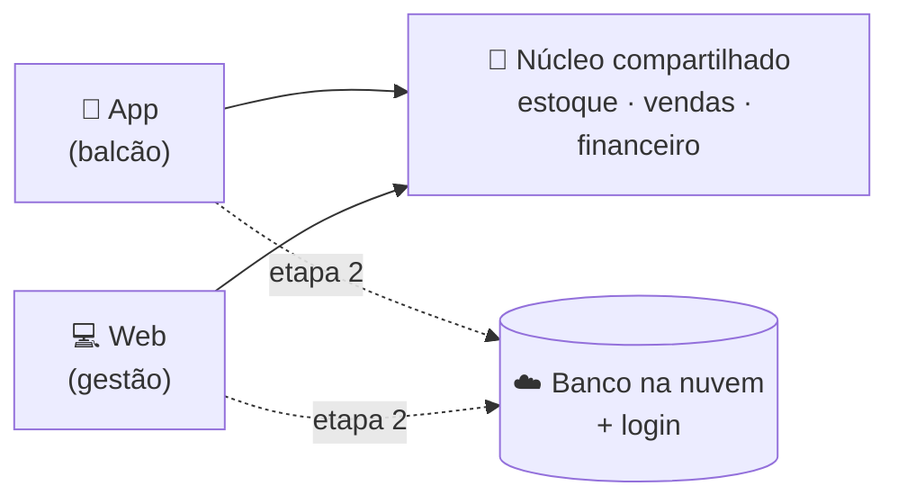
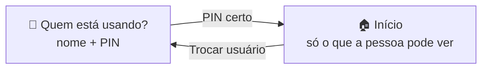
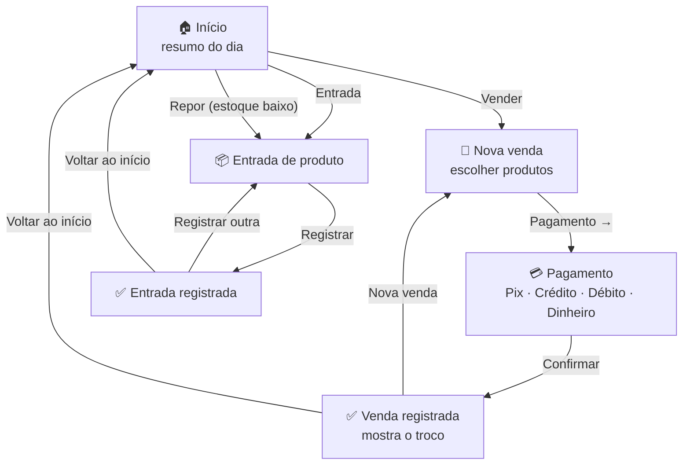
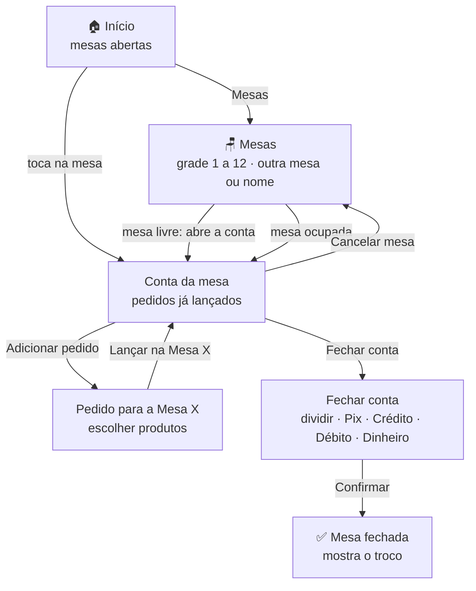
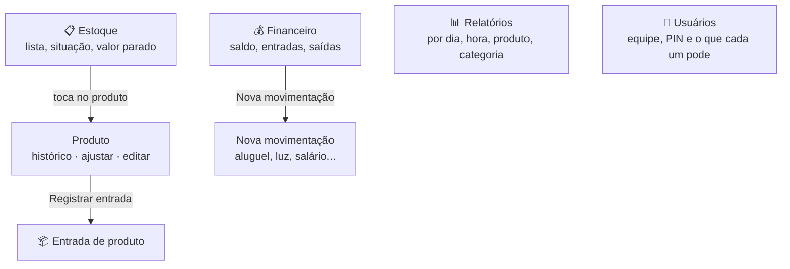
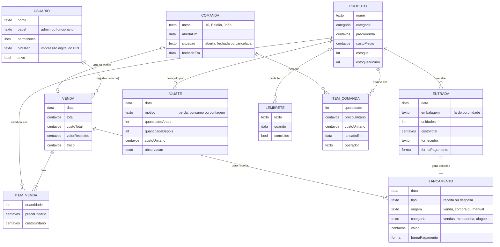

# Fluxo do sistema — Adegas

Documento de referência do esqueleto: quais telas existem, o que cada uma faz e o que muda no estoque e no financeiro a cada ação. Serve de base para as próximas etapas.

## 1. Visão geral

| Peça | Para quem | Para quê |
|---|---|---|
| 📱 **App** (`apps/mobile`) | Quem está no balcão | Vender, dar entrada em mercadoria, ver o resumo do dia. Botões grandes, poucas etapas. |
| 💻 **Web** (`apps/web`) | Dono / gestão no computador | As mesmas ações, com mais informação na tela: frente de caixa com carrinho lateral, tabelas, histórico. Depois: relatórios. |
| 🧠 **Núcleo** (`packages/core`) | App e web | As regras ficam escritas uma vez só: preço, estoque, custo médio, troco e lançamentos. App e web calculam igual. |
| 🤖 **Assistente** (`packages/ia`) | App e web | Conversa com IA (Gemini). Consulta e registra tudo pela plataforma por meio de um **servidor MCP**. Detalhes em [`ASSISTENTE.md`](ASSISTENTE.md). |
| ☁️ **Banco na nuvem** (próxima etapa) | App e web | É por ele que app e web "conversam": uma venda feita no celular aparece no web na hora. |

> **Hoje** os dados ficam na memória do aparelho/navegador e começam com produtos e vendas **de exemplo**. Ao fechar, volta tudo ao exemplo. Isso muda na etapa 2.

## 2. Mapa de telas

Antes de tudo, **quem está usando?** Cada pessoa da equipe toca no próprio nome e digita o **PIN de 4 números**. O menu e as telas mostram só o que aquela pessoa pode fazer (veja 3.9). "Trocar usuário" volta para esta tela.

**Mesas** (conta por mesa):

**Gestão** (abas no app; menu lateral no web):

No **app**, a barra de baixo tem até 5 abas: **Início, Estoque, Financeiro, Relatórios e Assistente** (cada pessoa vê só as que pode). Vender, Mesas e Entrada ficam nos botões grandes do Início, e as mesas abertas aparecem logo abaixo deles. Tocando no seu nome, no topo do Início, ficam **Usuários** (só administrador) e **Trocar usuário**.

No **web**, Mesas fica no menu, junto de Vender: a grade de mesas e os produtos à esquerda, a conta da mesa escolhida à direita (no celular, a conta aparece logo abaixo da grade). Usuários fica no menu de Gestão (só administrador), e o nome de quem está usando fica no pé do menu, com o botão de trocar.

No **web**, "Nova venda" e "Pagamento" ficam numa tela só (produtos à esquerda, carrinho e pagamento à direita), porque a tela é grande. No **app** são duas telas, para cada uma ter pouca coisa. Na tela de Estoque do web, o produto escolhido abre num painel ao lado da tabela.

## 3. As telas

### 3.1 Início

Mostra, de cara:

- **Vendido hoje**: total do dia, número de vendas e lucro bruto.
- **Quanto entrou em cada forma de pagamento** (Pix, Crédito, Débito, Dinheiro). Ajuda a conferir o caixa e a maquininha.
- **Botões grandes**: Vender e Entrada.
- **⚠️ Estoque baixo**: produtos que chegaram no mínimo definido, cada um com o botão **Repor**, que abre a entrada já com o produto escolhido.
- **Últimas movimentações**: vendas (verde, +) e compras (vermelho, −).

No web aparecem ainda o **ticket médio** e as **compras do dia** com o saldo (vendas − compras).

Quem não tem **Financeiro e relatórios** não vê os valores do dia (vendido, lucro, recebido, movimentações): vê os botões que pode usar, as mesas abertas, o que repor e os lembretes.

### 3.2 Entrada de produto (chegou mercadoria)

Três passos na mesma tela:

1. **Qual produto chegou?** Busca um produto já cadastrado, ou cadastra um **produto novo** ali mesmo (nome, categoria, preço de venda e quando avisar estoque baixo).
2. **Como chegou?** **Fardo/caixa** (ex.: fardo com 12 latas) ou **unidade**. Informa quantos e o custo de cada fardo (ou unidade).
3. **Compra:** fornecedor (opcional) e **como foi pago** (Pix, crédito, débito, dinheiro).

Enquanto preenche, o **resumo** mostra: quantas unidades entram, custo por unidade, **margem** sobre o preço de venda e total da compra.

**O que acontece ao registrar:**

- O estoque do produto **sobe** em unidades (4 fardos de 12 = +48 latas).
- O **custo médio** do produto é recalculado (ver regras abaixo).
- Entra uma **despesa** no financeiro, com a forma de pagamento usada.

### 3.3 Nova venda → Pagamento

**Nova venda:** os **mais vendidos** aparecem primeiro; depois busca por nome, filtro por categoria e botão **+** em cada produto. O carrinho não deixa passar do que tem em estoque. A barra de baixo mostra itens e total.

**Pagamento:**

1. Resumo do pedido e **total**.
2. **Como o cliente vai pagar?** Quatro botões grandes: **Pix**, **Crédito**, **Débito**, **Dinheiro**.
3. Cada forma mostra um lembrete:
   - Pix: conferir o Pix no app do banco antes de confirmar.
   - Crédito/Débito: passar na maquininha e confirmar quando aprovar.
   - **Dinheiro:** campo **valor recebido** com atalhos (valor exato e as próximas notas redondas, ex.: total R$ 31 → R$ 35, R$ 40, R$ 50) e o **troco** calculado na hora. Se faltar dinheiro, mostra quanto falta e não deixa confirmar.
4. **Confirmar** → tela de sucesso com o **troco em destaque**.

**O que acontece ao confirmar:**

- O estoque de cada item **baixa**.
- Entra uma **receita** no financeiro, na forma de pagamento escolhida.
- A venda guarda o custo de cada item naquele momento, para o lucro ficar certo mesmo se o custo mudar depois.

### 3.4 Estoque

- **Resumo:** valor parado em estoque (pelo custo), quanto entraria vendendo tudo, unidades e quantos produtos precisam de reposição.
- **Lista** com busca, filtros (**Todos / Precisa repor / Sem estoque**) e categoria. Cada produto mostra estoque, mínimo e a situação: **Em dia**, **Baixo** ou **Sem estoque**.
- **Produto** (tocando na linha):
  - **Histórico:** vendas, entradas e ajustes do produto, do mais recente para o mais antigo.
  - **Ajustar:** corrige o estoque sem venda nem compra:
    - **Perda ou quebra:** garrafa quebrada, vencido, gelo derretido;
    - **Consumo próprio:** uso da casa ou brinde;
    - **Contagem:** contou a prateleira e o número é outro (o estoque passa a ser o contado).
  - **Editar:** nome, categoria, preço de venda e estoque mínimo, mostrando a margem nova. A quantidade só muda por venda, entrada ou ajuste.

### 3.5 Financeiro

- **Período:** Hoje, 7 dias, 30 dias ou Este mês.
- **Saldo** do período (entrou menos saiu), **Entradas**, **Saídas** e **Lucro bruto** com a margem.
- **Recebido por forma de pagamento**, para conferir maquininha, Pix e gaveta.
- **Para onde foi o dinheiro:** saídas por categoria (mercadoria, aluguel, luz/água/internet, funcionários, impostos, manutenção, outras).
- **Perdas** do período (quebras e consumo, pelo custo). Não é saída de caixa, mas é dinheiro que saiu do estoque.
- **Movimentações** (Todas / Entradas / Saídas). As lançadas à mão podem ser excluídas; vendas e compras não, porque mexeram no estoque.
- **Nova movimentação:** saída (aluguel, luz, salário...) ou entrada (outras receitas), com categoria, valor e forma de pagamento.

### 3.6 Relatórios

- **Faturamento, ticket médio, lucro bruto e margem** do período.
- **Vendas por dia:** colunas com o faturamento de cada dia (passe o mouse ou toque para ver o valor e quantas vendas).
- **Horários de pico:** as 3 horas com mais vendas e o gráfico por hora, com as de pico em destaque. Serve para decidir horário de funcionário e quando gelar mais cerveja.
- **Mais vendidos:** quantidade, faturamento e lucro de cada produto.
- **Por categoria** e **por forma de pagamento**, com a fatia de cada uma.

### 3.7 Mesas (conta por mesa)

Para quem atende em mesas: o cliente senta, os pedidos vão sendo lançados e a conta é fechada no fim, de uma vez.

- **Abrir:** toque numa mesa livre da grade (1 a 12) ou digite outro número ou um nome ("15", "Balcão", "João"). Não dá para abrir a mesma mesa duas vezes.
- **Lançar pedidos:** sempre por um **botão com o nome da mesa**, para não lançar na mesa errada. No app: "Adicionar pedido na Mesa 10" → escolhe os produtos (o topo mostra em amarelo "Pedido para a Mesa 10") → **Lançar na Mesa 10**. No painel: clicar nos produtos só **monta o pedido** (aparece "Pedido novo · Mesa 10, ainda não lançado"); ele entra na conta ao apertar **Lançar na Mesa 10** (no celular, numa barra fixa embaixo). Dá para descartar o pedido montado, e a conta não fecha com pedido montado e não lançado. **O item sai do estoque ao lançar**, porque a bebida já vai para a mesa. Não deixa lançar mais do que tem.
- **Tirar item e cancelar mesa:** só quem tem a permissão **Corrigir mesas** (e o administrador) vê o − ao lado do item e o "Cancelar mesa".
- **Corrigir:** o − de cada item tira da conta e devolve ao estoque.
- **Conta:** itens agrupados por produto, preço de cada um, total e há quanto tempo a mesa está aberta. O preço fica o da hora do pedido.
- **Fechar:** dividir por pessoas (só mostra quanto dá para cada um), forma de pagamento e troco no dinheiro. A conta vira **uma venda** (entra no financeiro e nos relatórios, com "Mesa 10" na descrição) e a mesa fica livre.
- **Cancelar mesa:** quando abriu por engano ou o cliente foi embora sem consumir. Tudo volta ao estoque e nada entra no caixa.
- **Fechadas hoje:** lista na tela de Mesas, com hora, forma de pagamento e total.

### 3.8 Assistente e lembretes

- **Assistente:** conversa em português. Ele usa as mesmas ações das telas (consultar estoque, registrar entrada e venda, lançar pedidos nas mesas e fechar a conta, lançar despesa, ajustar estoque, buscar financeiro e relatórios, criar lembretes) por meio de um servidor **MCP** e da API do **Gemini**. Mostra cada passo que fez e um atalho para conferir. Lista completa em [`ASSISTENTE.md`](ASSISTENTE.md).
- **Lembretes:** aparecem no Início (app e painel), do mais urgente para o mais distante; os atrasados ficam em laranja. Um toque no ✓ conclui. Hoje são criados pelo assistente.
- O assistente **só faz o que a pessoa logada pode fazer**: para um funcionário sem Financeiro, ele nem recebe as ferramentas de financeiro e relatórios, e não vê preço de custo nem margem.

### 3.9 Usuários e níveis de acesso

Dois níveis:

- **Administrador** (o dono): pode tudo, inclusive **cadastrar funcionários** e mudar o que cada um pode fazer.
- **Funcionário**: só o que o administrador ligar no cadastro dele.

| Permissão | O que libera |
|---|---|
| Vender no balcão | Nova venda e pagamento |
| Atender mesas | Abrir mesa, lançar pedidos e fechar a conta |
| Corrigir mesas | Tirar itens já lançados e cancelar mesa |
| Ver estoque | Quantidades e situação dos produtos (sem custo, se não tiver Financeiro) |
| Registrar entrada | Chegada de mercadoria (vira despesa no financeiro) |
| Ajustar estoque e preços | Perdas, contagem, editar produto e preço |
| Financeiro e relatórios | Faturamento, custos, lucro, despesas e relatórios |
| Usar o assistente | O assistente, limitado às permissões acima |

Funcionário novo já vem com **Vender, Atender mesas, Ver estoque e Usar o assistente**. Cadastro: nome, **PIN de 4 números** (guardado como "impressão digital", não o número) e as permissões. Quem sai da equipe tem o acesso desligado e o histórico continua. O sistema não deixa ficar sem nenhum administrador ativo, nem a pessoa tirar o próprio acesso.

Cada venda, entrada, despesa, ajuste e pedido de mesa guarda **quem fez** (o nome de quem estava logado).

> Os dados de exemplo vêm com **Dono** (administrador, PIN 1234), **Ana** (funcionária: vender, mesas, ver estoque e assistente; PIN 1111) e **Bruno** (funcionário que também corrige mesas e registra entrada; PIN 2222).

## 4. O que cada ação muda

| Ação | Estoque | Financeiro |
|---|---|---|
| Venda | − quantidade vendida de cada produto | + receita (na forma de pagamento) |
| Entrada de produto | + unidades; recalcula o custo médio | − despesa (na forma de pagamento) |
| Produto novo | cria o produto já com o estoque da 1ª entrada | − despesa da 1ª entrada |
| Ajuste (perda, consumo) | − unidades | não mexe no caixa; aparece como **perda** (pelo custo) |
| Ajuste (contagem) | estoque passa a ser o contado | nada |
| Editar produto | nada (muda nome, preço, mínimo) | nada |
| Nova movimentação | nada | + entrada ou − saída, na categoria escolhida |
| Lembrete | nada | nada (só aparece no Início até ser concluído) |
| Pedido na mesa | − quantidade pedida, na hora | nada ainda |
| Tirar da mesa | + volta ao estoque | nada |
| Fechar a conta da mesa | nada (já saiu nos pedidos) | + receita (na forma de pagamento), como uma venda |
| Cancelar mesa | + tudo volta ao estoque | nada |
| Cadastrar ou mudar usuário | nada | nada |

O assistente não tem regras próprias: cada ferramenta dele faz exatamente uma das ações acima.

## 5. Regras de negócio (já implementadas no núcleo)

- **Dinheiro em centavos.** Todo valor é guardado como número inteiro de centavos (R$ 12,50 = 1250), para não errar arredondamento. O campo aceita "12", "12,5", "1.234,56" ou "R$ 12,50".
- **Não vende o que não tem.** O carrinho para no estoque, e a venda é recusada se o estoque mudou nesse meio-tempo.
- **Custo médio ponderado.** Ex.: 10 latas a R$ 3,00 + chegam 10 a R$ 4,00 → 20 latas a R$ 3,50.
- **Fardo × unidade.** Compra em fardo, vende em unidade: o estoque é sempre contado em unidades.
- **Estoque baixo.** Cada produto tem um mínimo; ao chegar nele (ou abaixo), aparece no alerta.
- **Lucro bruto** = vendas − custo dos produtos vendidos. **Saldo** = tudo que entrou − tudo que saiu no período.
- **Situação do estoque:** zerado = sem estoque; no mínimo ou abaixo = baixo; acima = em dia.
- **Perda** = unidades que saíram por ajuste × custo médio no momento do ajuste.

## 6. Dados guardados

Venda, entrada, lançamento, ajuste e item de mesa têm também o campo **operador** (quem estava logado).

Categorias iniciais: Cervejas, Destilados, Vinhos, Refri e água, Energéticos, Cigarros, Gelo e carvão, Petiscos, Outros.

## 7. Etapas

| Etapa | O que entra | Situação |
|---|---|---|
| **1. Esqueleto** | Telas de Início, Entrada de produto e Venda/Pagamento no app e no web; regras de estoque, custo médio, troco e financeiro | ✅ pronto |
| **1.1 Design** | Visual neutro e sofisticado, ícones de linha, "mais vendidos" na venda. Comparativo com o Cplug em [`ANALISE-CPLUG.md`](ANALISE-CPLUG.md) | ✅ pronto |
| **1.2 Tema escuro e animações** | Tema escuro; animações em JavaScript nos botões, na troca de telas e nos números (contam até o valor) | ✅ pronto |
| **1.3 Cores de choperia** | **Preto, branco e amarelo de cerveja** (antes eram detalhes em roxo); ícone novo com caneca de chope. O texto sobre o amarelo é escuro, para ler bem; alertas viraram laranja para não se confundir com o amarelo | ✅ pronto |
| **2. Banco na nuvem + login** | App e web passam a ver os mesmos dados em tempo real; os usuários e PINs passam para a nuvem (hoje ficam no aparelho, o que serve para separar o que cada um vê, mas não é segurança de verdade). Sugestão: **Supabase** (banco Postgres, login e tempo real prontos, plano grátis para começar). Já pensar em **funcionar sem internet** | próxima |
| **3. Estoque** | Lista com situação e valor parado, editar produto e preço, ajuste por perda/consumo/contagem, histórico do produto | ✅ pronto (lote e validade ficam para depois) |
| **4. Financeiro e relatórios** | Períodos, saldo, entradas e saídas, despesas da loja, recebido por forma, perdas; relatórios por dia, hora, produto, categoria e forma | ✅ pronto |
| **4.1 Assistente com IA** | Conversa (Gemini) que consulta e registra tudo via servidor MCP: estoque, entradas, vendas, despesas, financeiro, relatórios e lembretes. O servidor MCP também roda no terminal para outros clientes (Gemini CLI etc.) | ✅ pronto (notificação dos lembretes e chave no servidor ficam para a etapa 2) |
| **4.2 Mesas** | Conta por mesa: abrir, lançar pedidos (sai do estoque na hora), tirar, dividir, fechar com forma de pagamento e troco, cancelar; mesas abertas no Início; o assistente também lança e fecha mesas | ✅ pronto (número de mesas fixo em 12 na grade; dá para abrir qualquer outro número ou nome) |
| **4.3 Usuários e acesso** | Entrar com nome e PIN; administrador × funcionário com permissões ligáveis; cadastro de funcionários; menus, telas e assistente respeitam a permissão; cada registro guarda quem fez. Mesas: pedido só entra pelo botão "Lançar na Mesa X" | ✅ pronto |
| **5. Caixa do dia** | **Abrir/fechar o caixa, sangria e reforço**, conferência do dinheiro da gaveta, taxa da maquininha | |
| **6. Extras** | Leitor de código de barras pela câmera, desconto na venda, pagamento dividido (parte Pix, parte dinheiro — o modelo de venda já aceita), fiado, vendas por funcionário (comissão), publicar o app nas lojas | |

## 8. Perguntas para decidir antes da etapa 2

1. Quer um relatório de **vendas por funcionário** (para comissão)? Os dados de quem vendeu já ficam guardados.
2. É **uma loja** ou mais de uma?
3. Vende **fiado** / tem cliente com conta?
4. Quer descontar a **taxa da maquininha** automaticamente (ex.: crédito 3%, débito 1,5%) para o lucro ficar real?
5. Vai precisar emitir **nota fiscal** (NFC-e) pelo sistema?
6. Faz sentido o app funcionar **sem internet** e sincronizar depois?
